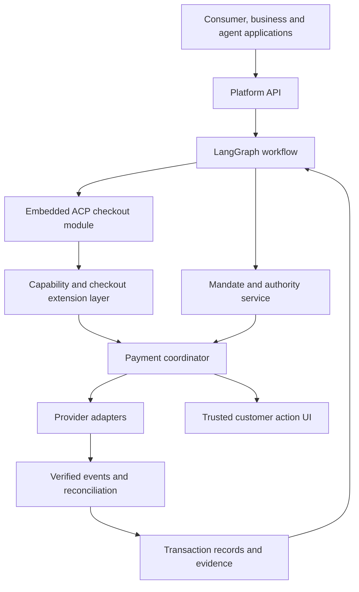

# Architecture concept

Status: draft design brief; 2026-11-06. This captures the requested composition. The detailed design gate in the [roadmap](roadmap.md) is not yet passed.

## Composition

The platform's PaymentIntent is the aggregate for an AP2-based authorized purchase workflow. It embeds an OpenAI ACP checkout integration. It is a platform object, not a claim that AP2 defines this aggregate or that it is a Stripe PaymentIntent.

## Component ownership

| Component | Owns | Does not own |
| --- | --- | --- |
| Intent application service | Intent lifecycle, tenant scope, command admission | Provider-authoritative settlement outcome |
| Checkout module | Merchant checkout snapshot/version, order linkage | Invented merchant prices or duplicate charges |
| Authority service | Verified grant/mandate references and checks | Issuer authentication decisions |
| Payment coordinator | Attempts, idempotency, dispatch, reconciliation, allocations | Unconditional retry after uncertain execution |
| Adapter registry | Versioned capabilities per account, region and channel | Assumed portability of tokens |
| Action service | Expiring provider interaction bound to an attempt | Model collection of OTPs or authentication secrets |
| Transaction persistence | State versions, reservations, events and evidence references | Shared writable graph memory |
| LangGraph | Task sequencing and human-intervention coordination | Authority to override transaction rules |

Use a modular core with domain/application/ports/infrastructure boundaries. Provider SDKs, HTTP and SQL are infrastructure concerns. A separate LangGraph process calls authenticated commands. Split into additional services only for a documented operational reason.

## Execution flow

1. An authenticated principal requests a platform intent. Parse suggestions from the agent but validate all binding data deterministically.
2. Create/update the embedded checkout and discover eligible payment capabilities.
3. Freeze the merchant-authoritative checkout version, payment allocations and execution owner for approval.
4. Obtain and verify authority bound to the required snapshot; reserve budget atomically.
5. Request checkout completion. If the merchant uses our payment coordinator, the merchant completion path invokes it. If an external merchant executes payments, delegate and observe; never also charge independently.
6. Perform provider preparation/authorization and required customer actions in the order supported by that integration.
7. Verify callbacks or query provider status; distinguish authentication, authorization, capture, settlement and order fulfilment.
8. Reconcile unknown outcomes before retry or route changes. Store actual evidence with provenance.

## Extensibility

Provider, method, credential format, customer action and checkout allocation are separate extension axes. Capabilities are intersected with the merchant account, currency, country, channel, authorization profile and provider support. Mandatory unknown capabilities reject; no silent downgrade.

The ACP boundary remains pinned to the selected external contract. Current documentation has restricted provider/method/status enums. Broader internal capabilities need a separately negotiated extension/hosted continuation contract; do not invent accepted ACP fields or collapse pending into success. See [sources](references.md) and [review](reviews/0001-protocol-boundaries.md).

## Trust and persistence

- Money uses exact currency-aware minor units; conversions and rounding are explicit.
- Aggregate budget reservation and intent transition use database concurrency control. Define revocation versus dispatch ordering in detailed design.
- Persist commands before external side effects, stable provider idempotency identities and reconciliation work. Checkpoints cannot close the provider-success/local-crash gap.
- Customer actions are bound to tenant, principal, attempt, checkout version and expiry. Browser redirects do not establish payment success.
- Keep raw credentials, provider action secrets and signing keys outside model context/checkpoints/logs. Use managed keys and established verification libraries.
- Split tender is a saga with declared compensation limits. Discounts modify the price; stored-value vouchers fund allocations.
- Keep native signed payload bytes and their digests for verification. Normalized models are not substitutes for signed source material.

## Design gate

Resolve signed-byte mapping, AP2 actor/trust matrix, external ACP continuation, execution ownership, unknown-outcome state transitions, revocation linearization and split-tender compensation before implementing payment execution. The initial review identifies evidence required to close each issue.
