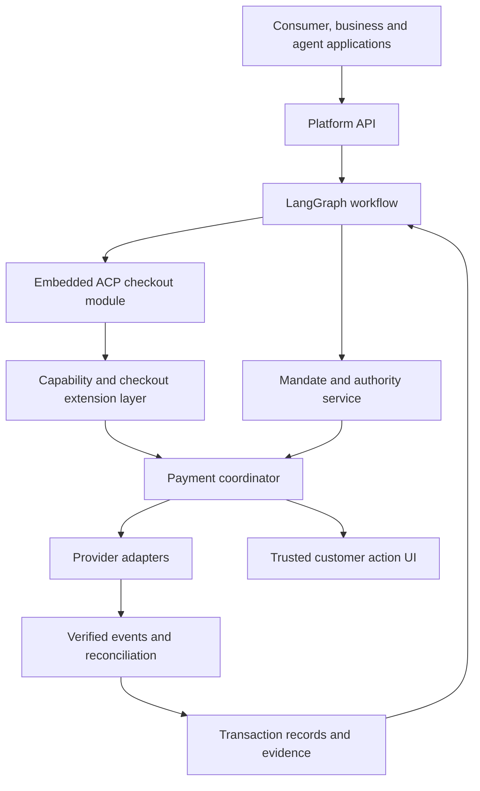

# Architecture concept

Status: platform composition brief, updated 2026-11-08. Bounded reference and independent AP2 designs have separate accepted [gate records](reviews/gates.md). The broader real-provider and managed-platform design gates in the [roadmap](roadmap.md) remain open.

## Composition

The platform's PaymentIntent is the aggregate for an AP2-based authorized purchase workflow. It embeds an OpenAI ACP checkout integration. It is a platform object, not a claim that AP2 defines this aggregate or that it is a Stripe PaymentIntent.

## Component ownership

| Component | Owns | Does not own |
| --- | --- | --- |
| Intent application service | Intent lifecycle, tenant scope, command admission | Provider-authoritative settlement outcome |
| Checkout module | Merchant checkout snapshot/version, order linkage | Invented merchant prices or duplicate charges |
| Authority service | Verified grant/mandate references and checks | Issuer authentication decisions |
| Payment coordinator | Attempts, idempotency, dispatch, reconciliation, allocations | Unconditional retry after uncertain execution |
| Adapter registry | Versioned capabilities per account, region and channel | Assumed portability of tokens |
| Action service | Expiring provider interaction bound to an attempt | Model collection of OTPs or authentication secrets |
| Transaction persistence | State versions, reservations, events and evidence references | Shared writable graph memory |
| LangGraph | Task sequencing and human-intervention coordination | Authority to override transaction rules |

Use a modular core with domain/application/ports/infrastructure boundaries. Provider SDKs, HTTP and SQL are infrastructure concerns. A separate LangGraph process calls authenticated commands. Split into additional services only for a documented operational reason.

The independently authored [Java AP2 engine](ap2-engine.md) supplies a bounded synthetic direct TAP mandate/receipt verifier and role exchange. The explicit [native composition](durable-composition.md) binds its verified authority and exact embedded ACP checkout to durable admission, with atomic replay consumption and reservation. LangGraph does not acquire signing keys or native authority artifacts. It runs bounded decisions through a replaceable [durable runtime](durable-runtime.md); PostgreSQL remains the reference authority for payment state.

For native composition, `NativeApplicationCoordinator` centralizes exact artifact handling and verification policy using the existing ports. `JdbcPaymentStore` retains transaction ownership and the explicit provisioning, trust-snapshot and financial-admission ordering. This is a bounded application-layer extraction; overall financial-use-case coordination still needs further separation. See [ADR 0008](adr/0008-native-application-coordination.md).

`ExecutePayment` now owns execution-command authorization, accepted-command replay, grant/state checks and operation binding through one typed `PaymentCommandTransactions` boundary. JDBC retains the indivisible operation/outbox/state/audit/command writes and existing retry rules. Approval, worker dispatch and full admission-backend extraction remain separate work; see [ADR 0010](adr/0010-payment-transaction-boundary.md).

The standalone [external checkout client](external-checkout.md) implements create/retrieve/update/cancel through the replaceable `CheckoutSessions` contract. Its network calls are not wired into the current transaction-bound native checkout. Future integration must durably stage commands, send outside the lock and recheck current checkout/authority binding before admission. The [provider roadmap](provider-adapter-evolution.md) covers the executable SDK evolution needed for real PSPs.

## Execution flow

1. An authenticated principal requests a platform intent. Parse suggestions from the agent but validate all binding data deterministically.
2. Create/update the embedded checkout and discover eligible payment capabilities.
3. Freeze the merchant-authoritative checkout version, payment allocations and execution owner for approval.
4. Obtain and verify authority bound to the required snapshot; reserve budget atomically.
5. Request checkout completion. If the merchant uses our payment coordinator, the merchant completion path invokes it. If an external merchant executes payments, delegate and observe; never also charge independently.
6. Perform provider preparation/authorization and required customer actions in the order supported by that integration.
7. Verify callbacks or query provider status; distinguish authentication, authorization, capture, settlement and order fulfilment.
8. Reconcile unknown outcomes before retry or route changes. Store actual evidence with provenance.

## Extensibility

Replaceability and composition apply to every component interface, not only payment-provider adapters. Protocol engines, checkout integrations, authority verification, signing and key services, artifact storage, grant/admission coordination, authentication, events, identity and orchestration need explicit behavioral contracts. A caller depends on the contract; implementations may be native, external adapters, decorators or delegated compositions. Reference implementations demonstrate the contracts without making their backend mandatory.

Define each interface once around its responsibility, not around a vendor. For example, an immutable signed-artifact store may have Azure Storage, DynamoDB, PostgreSQL or payment-grant-service adapters, all implementing the same contract. A future backend adds a concrete implementation and configuration/registration; it does not require a new interface or workflow/domain changes. The same rule governs every other component boundary.

In particular, this platform must support its AP2 implementation paired with an external ACP implementation, or its AP2 and ACP implementations with the ACP layer adapting/delegating to an external implementation. The same boundary applies to cryptographic implementations and storage. Actual algorithm support remains constrained by negotiated protocol profiles and trusted policy. Signed-artifact storage, such as an immutable object store, is separate from the service that atomically consumes a grant and admits a payment. Replacement tests must establish the guarantees callers rely on, including failures and recovery.

Provider, method, credential format, customer action and checkout allocation are separate extension axes. Capabilities are intersected with the merchant account, currency, country, channel, authorization profile and provider support. Mandatory unknown capabilities reject; no silent downgrade.

The ACP boundary remains pinned to the selected external contract. Current documentation has restricted provider/method/status enums. Broader internal capabilities need a separately negotiated extension/hosted continuation contract; do not invent accepted ACP fields or collapse pending into success. See [sources](references.md) and [review](reviews/0001-protocol-boundaries.md).

## Trust and persistence

- Money uses exact currency-aware minor units; conversions and rounding are explicit.
- Aggregate budget reservation and intent transition use database concurrency control. Define revocation versus dispatch ordering in detailed design.
- Persist commands before external side effects, stable provider idempotency identities and reconciliation work. Checkpoints cannot close the provider-success/local-crash gap.
- Customer actions are bound to tenant, principal, attempt, checkout version and expiry. Browser redirects do not establish payment success.
- Keep raw credentials, provider action secrets and signing keys outside model context/checkpoints/logs. Use managed keys and established verification libraries.
- Split tender is a saga with declared compensation limits. Discounts modify the price; stored-value vouchers fund allocations.
- Keep native signed payload bytes and their digests for verification. Normalized models are not substitutes for signed source material.

## Design gate

Resolve signed-byte mapping, AP2 actor/trust matrix, external ACP continuation, execution ownership, unknown-outcome state transitions, revocation linearization and split-tender compensation before implementing payment execution. The initial review identifies evidence required to close each issue.
